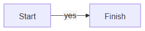

# A reviewable example: input, reference and actual candidate result

This example explains the evidence format. It is **not a new Asrai rendering capability**. The visual was produced by the pinned Mermaid reference; the actual Asrai response below remains unimplemented.

## Small input

```text
flowchart LR
A[Start] -->|yes| B[Finish]
```

## Mermaid reference only



[Open the reference SVG](reference.svg). Producer: Mermaid **11.17.2**, Playwright **1.65.1**, Chromium **159.0.8154.6** on Windows, using `reference/config.json`. Input fixture: `edge-label`. Regenerate with `npm run reference:capture`; the tracked `reference/observations.json` records fixture/config/lock/adapter hashes. The preview copies `artifacts/reference/edge-label.png` and `.svg` from that capture. It illustrates the target behavior; it is not an Asrai acceptance result.

## Actual Asrai result

Run the product adapter with a render request:

```sh
node --input-type=module -e 'import {execute} from "./src/index.mjs"; console.log(JSON.stringify(await execute({protocolVersion:1,operation:"render",source:"flowchart LR\nA[Start] -->|yes| B[Finish]"})))'
```

Actual output from the founding product stub:

```json
{"status":"unimplemented","code":"ASRAI_NOT_IMPLEMENTED"}
```

For the first ready capability, `npm run evaluate -- --capability FC001` exits 1 with **0/6 passed**, all six explicitly unimplemented. The complete current milestone has **0/73 passed**. These are expected gaps, not CI failures to hide by weakening criteria.

## What the PR changes instead

Before setup, `factory:next` produced a local task with no GitHub issue, and the repository had no feature/bug forms or review-description contract. After setup, the same task includes its linked capability issue; the issue provides the desired behavior and acceptance cases; the PR explains interfaces and examples; CI presents readable results and keeps implementation separate from contract proposals.

| Boundary | Input | Output | Responsibility |
| --- | --- | --- | --- |
| Request → issue | Desired outcome and example | Human-readable feature/bug/factory issue | Owner defines intent; agent supplies engineering analysis |
| Capability → issue/task | Registry ID, dependencies and criteria | Linked issue draft and task packet | Registry controls acceptance; issue controls discussion and work visibility |
| PR → review contract | Body, changed paths, base policy/capabilities | Structured context and missing-information failures | Check readability structure and reject mixed implementation/criteria changes |
| Candidate → acceptance | Source-only candidate, fixed base harness | Digest-bound pass/fail report | Evaluate product independently from its implementation |
| Report → owner review | Results and previews | Short CI summary plus full artifacts | Expose evidence without requiring the owner to reconstruct logs |

The setup PR demonstrates the template with a real issue and these labeled assets. Future visual implementation PRs must replace reference-only imagery with actual Asrai candidate output and include its SVG, source and evaluated revision.
