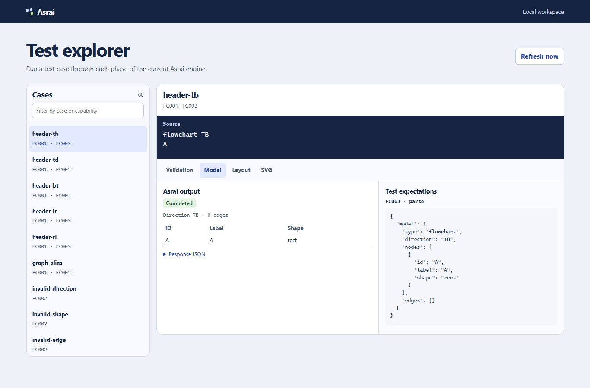

# Live Asrai test explorer

Run this from the repository root:

```sh
node docs/reviews/interactive/preview.mjs
```

Open [the local test explorer](http://127.0.0.1:4173/). Choose a case, then select **Validation**, **Model**, **Layout**, or **SVG**. Each phase shows the live Asrai response and that case’s expectations, when available. Layout draws the returned node bounds and edge paths. SVG displays the image returned by the engine and gives access to its markup.

The catalog includes authored flowchart fixtures and the evaluator’s seeded generated cases, including cases for work still in progress. The page checks for changes every two seconds while visible. Saving a fixture or generator update refreshes the catalog. Saving product code reruns the selected phase. Every run starts a fresh adapter process, so new engine behavior is available without rebuilding or restarting the explorer. **Refresh now** runs the selected phase immediately.

By default the explorer uses its own checkout. To follow another worktree, pass its path and optionally a different port:

```sh
node docs/reviews/interactive/preview.mjs 4175 --workspace "/path/to/Asrai"
```

The runner binds to loopback, calls Asrai’s regular adapter using the configured process limits, and reads expectations from the chosen worktree. The independent evaluator remains the source of acceptance verdicts.



The screenshot shows the authored `header-tb` case and an actual model response. The interactive catalog opens on the first fixture by default.

## Browser verification

```sh
npm run reference:install
npm run reference:browser
node docs/reviews/interactive/verify.mjs
```

The browser check starts its own preview and uses a temporary workspace to exercise live fixture changes and rendering. Pass a filename as the first argument to capture the real-workspace model view.
